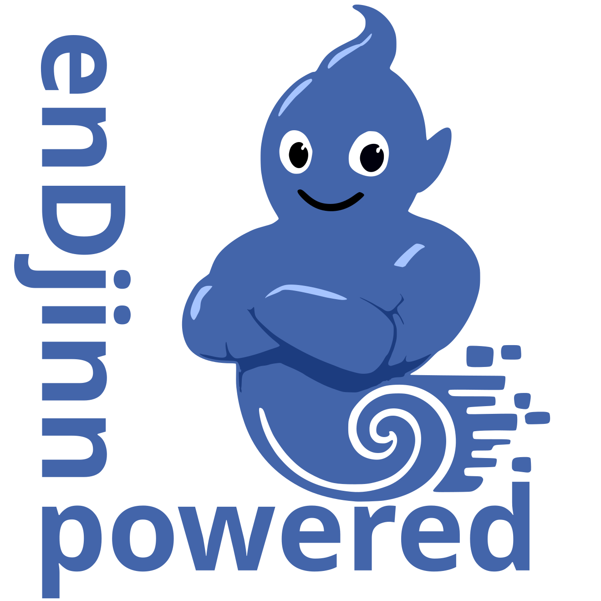

# enDjinn

enDjinn (a play on “engine” and the invisible helper of myth) is a small,
Dreamcast-first C runtime and build system. It handles recurring KOS/PVR
boilerplate while keeping the Dreamcast rendering model visible: applications
work with modes, PVR render lists, controllers, textures, fonts, sound, and
rumble devices rather than a generic cross-platform scene API.

It is available under the permissive [MIT License](./LICENSE).

<div>

</div>

## What it provides

- A frame loop that owns PVR scene setup and teardown.
- A stack of `enj_mode_t` game modes, including activation callbacks and soft
  reset support.
- Render-list callbacks for the opaque, punch-through, translucent and
  modifier-volume PVR lists.
- Controller state transitions, abstract controllers, and rate-limited rumble.
- Build-time conversion of supported texture, TrueType font, and sound assets.
- A built-in quick font (`qfont`) for fast text rendering, plus generated
  proportional `.enjfont` files.
- `dctrace` and `dcprof` profiling helpers.
- `pc-endjinn` (SDL2/Vulkan) and `web-endjinn` (Emscripten/WebGL 2)
  development backends that compile the same application source.

## Requirements and project status

enDjinn uses GNU C23 and is integrated as source rather than as a prebuilt
library. Dreamcast/KallistiOS is the reference target. The PC and browser
backends are for development; they are not Dreamcast emulators.

The API is still evolving and there is no versioned stable ABI yet. External
projects should pin a known Git commit (for example with a submodule) and review
public-header changes when updating.

## Quick start: Dreamcast

With a KallistiOS environment active, create a project with `code/`, a
`local.cfg.mk`, and a `Makefile` symlink to `base_link.mk`:

```sh
mkdir -p my-game/code
cd my-game
ln -s /path/to/enDjinn/base_link.mk Makefile
printf 'ENJ_INJECT_QFONT:=1\n' > local.cfg.mk
```

Put a minimal application in `code/`, for example this shortened form of the
[hello example](./examples/enj_hello/code/enj_hello.c):

```c
#include <enDjinn/enj_enDjinn.h>

void render(void *__unused) {
  enj_qfont_write("Hello, enDjinn!", 20, 20, PVR_LIST_PT_POLY);
}

void update(void *__unused) {
  enj_render_list_add(PVR_LIST_PT_POLY, render, NULL);
}

int main(__unused int argc, __unused char **argv) {
  enj_state_init_defaults();
  if (enj_state_startup() != 0) return -1;

  enj_mode_t mode = {.name = "Main", .mode_updater = update};
  enj_mode_push(&mode);
  enj_state_run();
  return 0;
}
```

Then run `make`. The default target is `bin/my-game.elf`;
`make bin/my-game.cdi` builds a disc image. The same project builds for the
development backends:

```sh
make ENJ_TARGET=pc-endjinn     # ./build/pc-endjinn/my-game
make ENJ_TARGET=web-endjinn    # build/web-endjinn/my-game.html
```

## Documentation

The [documentation index](./docs/README.md) lists every guide and reference,
grouped by task. Good starting points:

- [Getting started](./docs/getting-started.md) for prerequisites and the first build.
- [Using enDjinn in another project](./docs/USING_ENDJINN.md) for the
  integration contract.
- The [examples](./examples/README.md), which are the best source of working,
  feature-specific code.
